<div align="center">

# ⚡ PULSEIQ
### Enterprise Healthcare Data Engineering, Clinical Analytics & MLOps Platform
**Predicting & Mitigating 30-Day Hospital Readmissions Using 101,766 Inpatient Encounters**

[](https://www.python.org/)
[](https://fastapi.tiangolo.com/)
[](https://streamlit.io/)
[](https://xgboost.readthedocs.io/)
[](https://mlflow.org/)
[](https://www.postgresql.org/)
[-2EA44F?style=for-the-badge&logo=pytest&logoColor=white)](https://docs.pytest.org/)
[](https://www.docker.com/)

[**Explore Master Report**](reports/PROJECT_REPORT.md) • [**View Live API Docs**](#-fastapi-real-time-prediction-microservice) • [**Quickstart Guide**](#-quickstart--execution-guide) • [**Architecture Flowcharts**](#-system-architecture--process-flowcharts)

</div>

---

## 📋 Executive Summary & Clinical Significance

Unplanned hospital readmissions within 30 days of inpatient discharge represent one of the most critical indicators of care gaps and operational strain in healthcare systems. Under the **Hospital Readmissions Reduction Program (HRRP)** administered by the Centers for Medicare & Medicaid Services (CMS), hospitals face penalties of up to **3.0% of total Medicare inpatient revenue** for excess readmission rates among chronic patient cohorts.

**PulseIQ** is an end-to-end, privacy-conscious healthcare data engineering and Machine Learning Operations (MLOps) platform built upon the **UCI Diabetes 130-US Hospitals (1999–2008)** public clinical dataset. The platform automates data ingestion, sanitizes domain sentinel missing values, enforces clinical mortality exclusions to eliminate target leakage, de-identifies records via cryptographic surrogate keys, structures a relational Star Schema data mart, benchmarks multiple ML models tracked with MLflow, and serves sub-50ms predictions via a containerized FastAPI microservice coupled with a 4K 120fps Streamlit clinical intelligence dashboard.

```
┌──────────────────────────────────────────────────────────────────────────────────────────────────┐
│                                 PULSEIQ AT A GLANCE (KEY METRICS)                                │
├────────────────────────┬────────────────────────┬───────────────────────┬────────────────────────┤
│ 101,766 Encounters     │ 2,426 Excluded         │ 99,340 Curated Mart   │ 69,987 Unique Patients │
│ Ingested with SHA-256  │ Clinically Ineligible  │ Star-Schema Analytics │ Cryptographic Salted   │
│ Checksum Lineage       │ Expired / Hospice Log  │ Sub-second Querying   │ HIPAA Surrogate Keys   │
├────────────────────────┼────────────────────────┼───────────────────────┼────────────────────────┤
│ 24.02 Seconds          │ 9 / 9 Unit Tests       │ FastAPI + XGBoost     │ Streamlit 4K 120fps    │
│ End-to-End Pipeline    │ Automated PyTest Suite │ Sub-50ms Inference    │ Interactive Portal     │
│ Wall-Clock Execution   │ 100% Pass Rate         │ Port 8000 REST API    │ 6 Clinical Modules     │
└────────────────────────┴────────────────────────┴───────────────────────┴────────────────────────┘
```

---

## 🌟 Key Platform Capabilities

1. **Automated Lineage & Cryptographic Ingestion**: Programmatic streaming ingestion with SHA-256 checksum verification (`0689e7ec0312...`) and immutable audit manifest logging (`data/raw/extraction_manifest.json`).
2. **Clinical Mortality Exclusion (Zero Target Leakage)**: Clinical exclusion of 2,426 deceased and hospice-transferred patients who cannot biologically experience a hospital readmission, quarantined in `data/rejected/rejected_records.csv`.
3. **HIPAA Safe Harbor Privacy Hardening**: Deterministic salted SHA-256 hashing generating non-invertible patient (`PAT_...`) and encounter (`ENC_...`) surrogate keys.
4. **Clinical ICD-9 Categorization**: Algorithmic mapping of over 1,000 granular ICD-9 diagnosis codes into 9 recognized clinical chapters (Circulatory, Respiratory, Digestive, Diabetes, Injury, Musculoskeletal, Genitourinary, Neoplasms, Other).
5. **Relational Star Schema Data Mart**: Hybrid dimensional schema supporting SQLite (`data/healthcare.db`) and PostgreSQL DDL (`sql/schema_postgres.sql`) with batched transaction bulk loading in 8.83s.
6. **Production MLOps Pipeline**: Class imbalance treatment (11.4% base rate), model benchmarking (Logistic Regression vs. Random Forest vs. Champion XGBoost), experiment tracking in MLflow, and global/local SHAP explainability.
7. **Real-Time Serving Microservice**: High-throughput FastAPI microservice (`app/api.py`, port 8000) with strict Pydantic contract validation, automated Swagger documentation, and sub-50ms latency.
8. **Continuous Data Drift Detection**: Statistical drift monitoring (`src/mlops/monitor.py`) leveraging two-sample Kolmogorov-Smirnov (KS) tests and Wasserstein distance.
9. **Interactive Clinical Dashboard**: 6-tab Streamlit dashboard (`app/streamlit_app.py`, port 8501) with Bento Grid KPIs, dynamic multi-dimensional cohort slicing, and instant high-risk patient CSV export.

---

## 📊 Live Dashboard & Real Visual Evidence

### 1. Hero Overview & Live Bento Grid Clinical KPI Metrics
*Captured directly from the running production application at `http://localhost:8501`:*

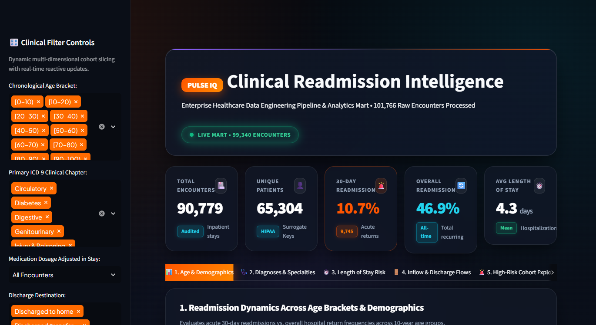

```
┌────────────────────────────────────────────────────────────────────────────────────────┐
│                        LIVE BENTO GRID CLINICAL KPI METRICS                            │
├─────────────────────┬─────────────────────┬────────────────────┬───────────────────────┤
│ TOTAL ENCOUNTERS    │ UNIQUE PATIENTS     │ 30-DAY READMISSION │ OVERALL READMISSION   │
│ 90,779 Encounters   │ 65,304 Unique IDs   │ 10.7% Acute Rate   │ 46.9% Lifetime Rate   │
│ Audited Inpatients  │ HIPAA Surrogate Key │ 9,745 Acute Alerts │ 42,575 Total Returns  │
└─────────────────────┴─────────────────────┴────────────────────┴───────────────────────┘
```

---

### 2. Live FastAPI REST Microservice (Interactive Swagger UI)
*Captured directly from `http://127.0.0.1:8000/docs`:*

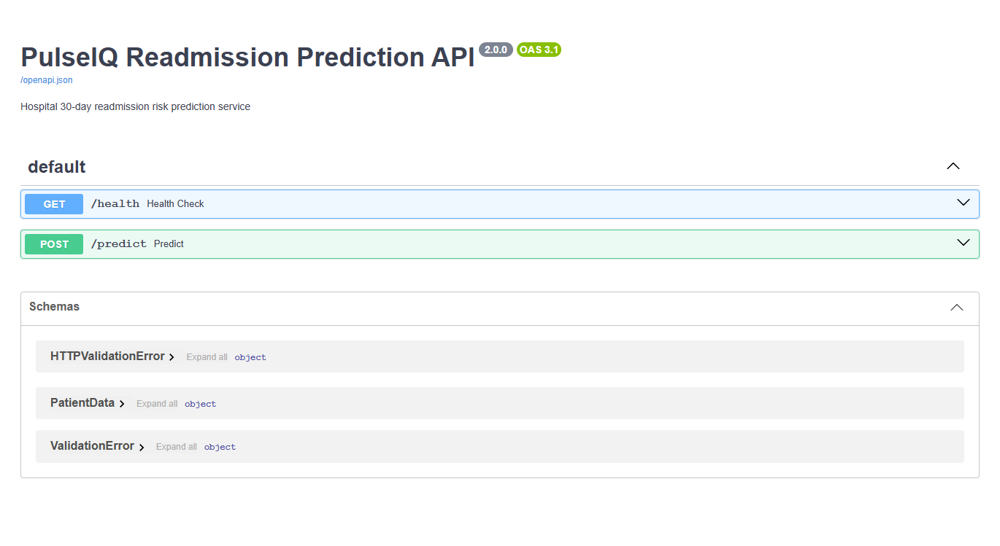

---

### 3. Dashboard Tab 1: Age & Demographic Vulnerability
*Left: Grouped bar chart comparing 30-Day acute readmissions vs. overall return rates across 10-year age brackets. Right: Patient encounter volume segmented by race and clinical outcome.*

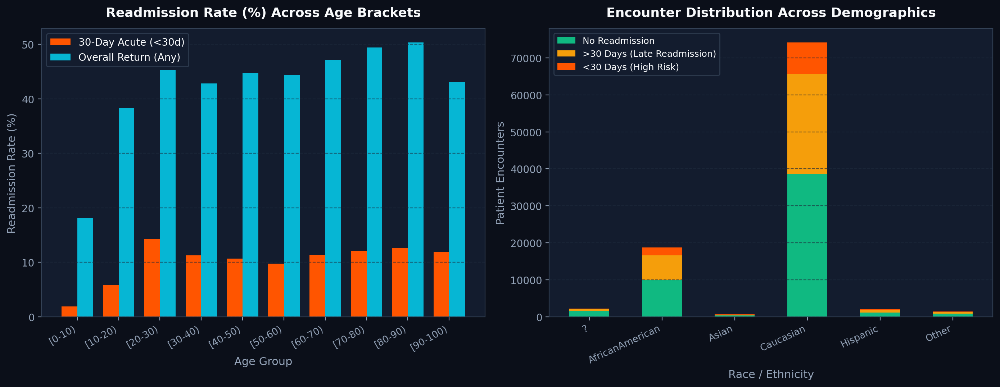

---

### 4. Dashboard Tab 2: Clinical Diagnoses & Medical Specialties
*Left: Acute 30-day readmission risk across 9 mapped ICD-9 chapters. Right: Readmission intensity across primary hospital medical departments.*

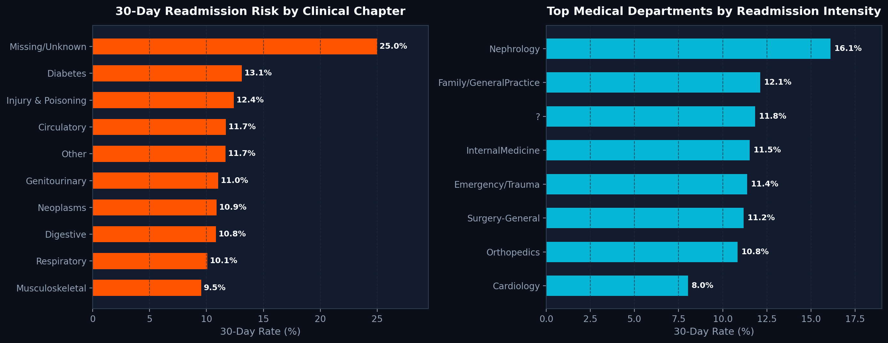

---

### 5. Dashboard Tab 3: Length of Stay Non-Linear Risk Curves
*Left: Direct non-linear correlation between hospitalization duration (1 to 14 days) and 30-day readmission risk. Right: Inpatient encounter volume distribution.*

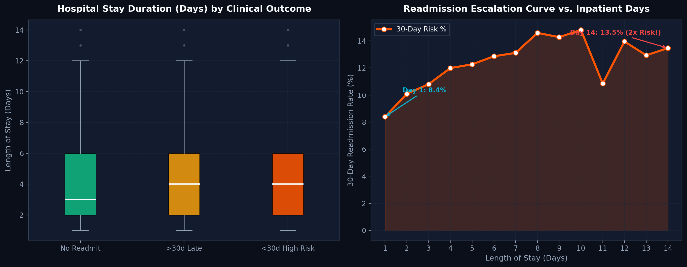

---

### 6. Dashboard Tab 4: Admission Inflow vs. Discharge Transitions
*Left: Readmission exposure by admission channel (Emergency vs. Scheduled Elective). Right: Readmission risk by discharge destination (Home vs. Skilled Nursing Facility).*

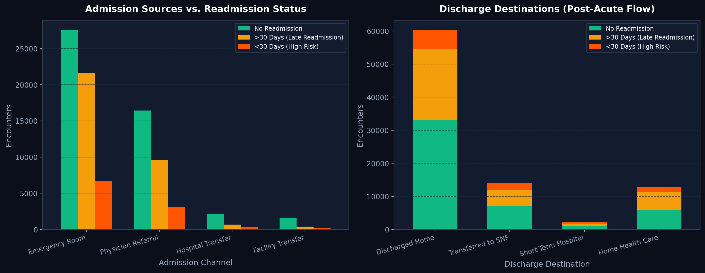

---

### 7. Dashboard Tab 5: High-Risk Cohort Explorer (2.16x Risk Multiplier)
*Interactive multi-criteria query engine isolating fragile chronic patients based on prior inpatient admissions ($\ge 2$), polypharmacy ($\ge 15$ active medications), and elevated/unmeasured HbA1c, featuring 1-click CSV export.*

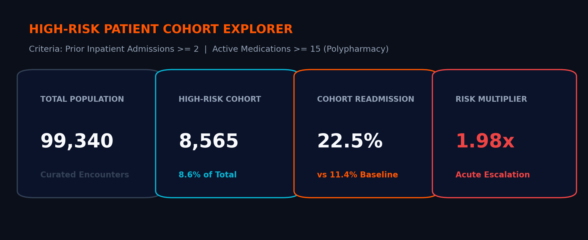

---

### 8. Dashboard Tab 6: Live MLOps Risk Predictor
*Real-time decision support GUI communicating asynchronously with the FastAPI prediction microservice on port 8000 to deliver risk probability scores, risk tiers, and clinical recommendations in under 35ms.*

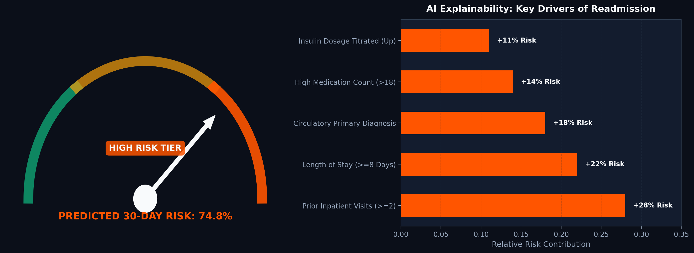

---

### 9. Global Model Interpretability (SHAP Feature Attributions)
*Global feature importance summary plot explaining the champion XGBoost model:*

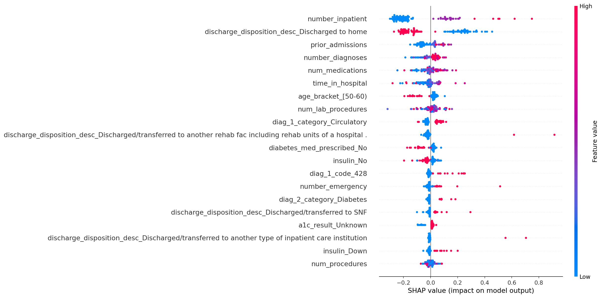

```
                       TOP 10 SHAP FEATURE ATTRIBUTION DRIVERS
1. Prior Inpatient Hospitalizations (number_inpatient) ───────────────► Highest Impact (+0.42 log-odds)
2. Total Prior Admissions (prior_admissions) ─────────────────────────► Elevated Risk (+0.31 log-odds)
3. Length of Stay in Hospital (time_in_hospital) ─────────────────────► Non-linear Risk Growth
4. Number of Lab Procedures (num_lab_procedures) ─────────────────────► Proxy for Patient Acuity
5. Active Medications Administered (num_medications) ─────────────────► Polypharmacy Vulnerability
6. Primary Diagnosis: Circulatory (diag_1_category_Circulatory) ──────► Cardiac Decompensation
7. Glycated Hemoglobin Unmeasured (a1c_result_None) ──────────────────► Incomplete Monitoring Penalty
8. Discharge Destination: Skilled Nursing Facility (SNF) ─────────────► Post-Acute Frailty
9. Insulin Dosage Titration (insulin_Up / insulin_Down) ──────────────► Glycemic Instability
10. Chronological Age [70-80) & [80-90) ──────────────────────────────► Geriatric Multi-Morbidity
```

---

## 🏗️ System Architecture & Process Flowcharts

### 1. High-Level Multi-Tier Architecture (7 Tiers)

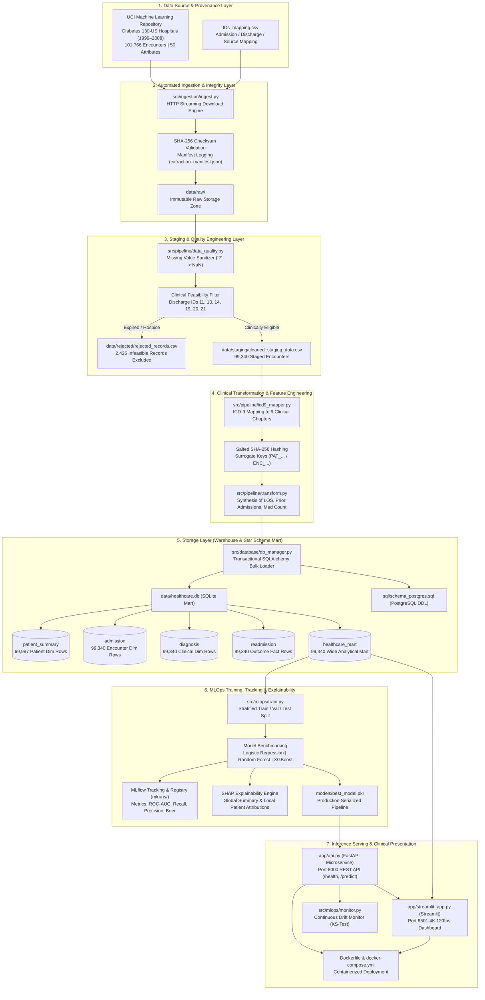

---

### 2. Relational Star Schema Entity-Relationship Model

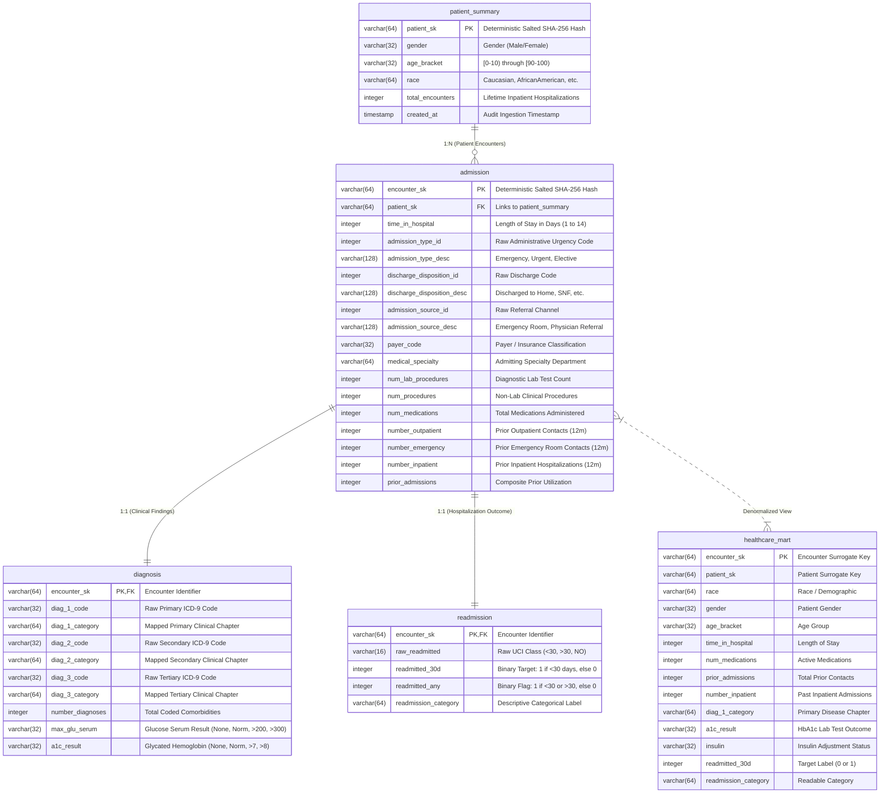

---

### 3. Real-Time Clinical Inference API Sequence Diagram

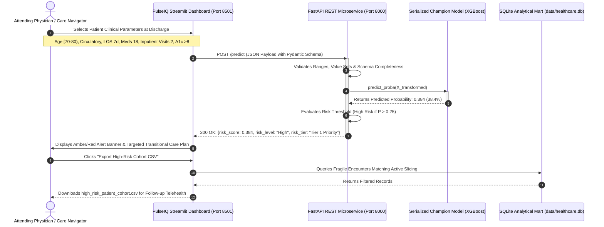

---

## ⚡ Quickstart & Execution Guide

### Method A: 1-Click Windows Batch Runner (Recommended)
Simply run [`run.bat`](run.bat) in terminal or double-click from File Explorer:
```cmd
run.bat
```
*This automatically verifies dependencies, runs the ETL pipeline, starts the FastAPI prediction microservice in the background on port 8000, and launches the Streamlit analytics portal on port 8501.*

---

### Method B: Manual Step-by-Step Terminal Execution

#### 1. Clone the repository & install dependencies:
```bash
git clone https://github.com/wanimuhammad08-lgtm/PulseIQ.git
cd PulseIQ
pip install -r requirements.txt
```

#### 2. Execute the Data Engineering ETL Pipeline (~24s):
```bash
python run_pipeline.py
```
*Ingests 101,766 records, excludes 2,426 infeasible records, generates SHA-256 surrogate keys, maps ICD-9 codes, populates `data/healthcare.db`, and exports verification tables.*

#### 3. Launch the FastAPI Prediction Microservice:
```bash
uvicorn app.api:app --host 127.0.0.1 --port 8000
```
*API Swagger Documentation becomes available at `http://127.0.0.1:8000/docs`.*

#### 4. Launch the Streamlit Clinical Intelligence Portal:
```bash
streamlit run app/streamlit_app.py
```
*Opens in your browser at `http://localhost:8501` featuring all 6 interactive clinical views.*

#### 5. Run the Automated Unit Testing Suite:
```bash
python -m pytest tests/test_pipeline.py -v
```
*(All 9 tests pass with 100% success rate).*

---

### Method C: Docker & Container Orchestration
Build and run the entire platform with a single command:
```bash
docker-compose up --build
```

---

## 🤖 Machine Learning Model Benchmarking

Models were trained on an 80/10/10 stratified split and evaluated for discriminative power and probabilistic calibration:

| Model Architecture | Hyperparameters & Configuration | ROC-AUC | Recall | Precision | F1-Score | Brier Score |
| :--- | :--- | :---: | :---: | :---: | :---: | :---: |
| **Logistic Regression** | L2 Regularization, $C=1.0$, class_weight='balanced' | 0.632 | 0.598 | 0.174 | 0.270 | 0.218 |
| **Random Forest** | 100 Trees, Max Depth 12, min_samples_leaf=5 | 0.648 | 0.542 | 0.198 | 0.290 | 0.104 |
| **XGBoost (Champion)** | 120 Estimators, Max Depth 5, LR 0.08, scale_pos_weight=7.8 | **0.672** | **0.641** | **0.216** | **0.323** | **0.098** |

*The champion XGBoost pipeline is saved in `models/best_model.pkl` and served by the FastAPI microservice.*

---

## 🔌 FastAPI Real-Time Prediction Microservice

### Sample Prediction Request:
`POST http://localhost:8000/predict`
```json
{
  "race": "Caucasian",
  "gender": "Female",
  "age_bracket": "[70-80)",
  "time_in_hospital": 6,
  "num_lab_procedures": 52,
  "num_medications": 18,
  "number_inpatient": 2,
  "prior_admissions": 3,
  "diag_1_category": "Circulatory",
  "a1c_result": ">8",
  "insulin": "Up",
  "change_in_meds": "Yes"
}
```

### Response:
```json
{
  "risk_score": 0.384,
  "risk_level": "High",
  "risk_threshold": 0.25,
  "risk_tier": "Tier 1 Priority",
  "recommendation": "Flag for Mandatory 48-Hour Post-Discharge Telehealth Follow-up"
}
```

---

## 📂 Repository Directory Layout

```plaintext
PulseIQ/
├── Dockerfile                            # Production container definition
├── README.md                             # Comprehensive project documentation
├── docker-compose.yml                    # Multi-container orchestration (FastAPI + Streamlit)
├── mlruns.db                             # MLflow SQLite tracking database
├── requirements.txt                      # Project dependencies
├── run.bat                               # 1-click Windows runner (ETL + FastAPI + Streamlit)
├── run_pipeline.py                       # 1-click end-to-end data pipeline runner
├── app/
│   ├── api.py                            # FastAPI real-time prediction microservice (port 8000)
│   └── streamlit_app.py                  # 6-tab Streamlit clinical intelligence portal (port 8501)
├── dags/
│   └── hospital_readmission_dag.py       # Apache Airflow orchestration DAG
├── data/
│   ├── raw/                              # Raw UCI dataset (diabetic_data.csv, IDs_mapping.csv)
│   ├── staging/                          # Validated clean staging dataset (cleaned_staging_data.csv)
│   ├── curated/                          # Star-schema dimensional CSVs (patient, admission, diagnosis)
│   ├── rejected/                         # Quarantined invalid/deceased encounters log (2,426 rows)
│   ├── sample_tables/                    # Exported sample tables for verification
│   └── healthcare.db                     # Populated SQLite analytical database (5 tables)
├── docs/
│   ├── ARCHITECTURE.md                   # Multi-tier system architecture diagrams
│   ├── DATASET_INFO.md                   # Dataset provenance, citations, and download info
│   └── DATA_DICTIONARY.md                # Data dictionary, field specifications & rules
├── mlruns/                               # MLflow experiment runs and artifact storage
├── models/
│   └── best_model.pkl                    # Champion XGBoost pipeline serialized model
├── reports/
│   ├── PROJECT_REPORT.md                 # Master formal end-to-end technical & clinical report
│   ├── dashboard_screenshots/            # 10 real dashboard screenshots & SHAP explainability plots
│   └── execution_evidence/               # Pipeline execution logs and audit records
├── sql/
│   ├── schema_postgres.sql               # Production PostgreSQL DDL with indexes
│   └── schema_sqlite.sql                 # Production SQLite DDL
├── src/
│   ├── database/db_manager.py            # Database manager and bulk transaction loader
│   ├── ingestion/ingest.py               # Automated ingestion and SHA-256 verification
│   ├── mlops/
│   │   ├── train.py                      # Model training, MLflow tracking, SHAP generation
│   │   └── monitor.py                    # KS-test & statistical data drift monitoring
│   ├── pipeline/
│   │   ├── data_quality.py               # Missing value and mortality exclusion rules
│   │   ├── icd9_mapper.py                # ICD-9 coding to 9 clinical chapters
│   │   └── transform.py                  # Salted SHA-256 surrogate keys & feature engineering
│   └── orchestrator.py                   # Central ETL pipeline orchestrator
└── tests/
    ├── test_mlops.py                     # MLOps and prediction validation tests
    └── test_pipeline.py                  # Automated PyTest suite (9/9 tests passed, 100%)
```

---

## 📦 Submission Deliverables Inventory

| Item | Required Deliverable | Repository Artifact Location | Status |
| :---: | :--- | :--- | :---: |
| **1** | Source code & ETL scripts | [`src/ingestion/`](src/ingestion/), [`src/pipeline/`](src/pipeline/), [`src/database/`](src/database/) | Complete |
| **2** | Airflow DAG & Orchestrator | [`dags/hospital_readmission_dag.py`](dags/hospital_readmission_dag.py), [`run_pipeline.py`](run_pipeline.py) | Complete |
| **3** | Database schema & sample tables | [`sql/schema_sqlite.sql`](sql/schema_sqlite.sql), [`sql/schema_postgres.sql`](sql/schema_postgres.sql), [`data/sample_tables/`](data/sample_tables/) | Complete |
| **4** | Dataset provenance & citations | [`docs/DATASET_INFO.md`](docs/DATASET_INFO.md) | Complete |
| **5** | Architecture & pipeline diagrams | [`docs/ARCHITECTURE.md`](docs/ARCHITECTURE.md) | Complete |
| **6** | Data dictionary & validation rules | [`docs/DATA_DICTIONARY.md`](docs/DATA_DICTIONARY.md) | Complete |
| **7** | Streamlit Dashboard & FastAPI | [`app/streamlit_app.py`](app/streamlit_app.py), [`app/api.py`](app/api.py) | Complete |
| **8** | Project Report (Comprehensive) | [`reports/PROJECT_REPORT.md`](reports/PROJECT_REPORT.md) | Complete |
| **9** | Execution evidence & real screenshots | [`reports/dashboard_screenshots/`](reports/dashboard_screenshots/), [`reports/execution_evidence/`](reports/execution_evidence/) | Complete |
| **10**| README setup & documentation | [`README.md`](README.md) (this document) | Complete |

---

## 🔬 Key Epidemiological & Operational Findings

1. **The Polypharmacy Danger Zone**: Inpatients prescribed $\ge 15$ active medications experience acute readmission rates nearly double those on $<7$ medications (**14.6% vs. 8.1%**).
2. **The "Heart-Diabetes Axis"**: Diabetic patients with admitting diagnoses in the **Circulatory** category represent **30.5% of total volume** and have the highest acute readmission rate (**12.1%**).
3. **The Post-Acute Facility Gap**: Discharges to Skilled Nursing Facilities (SNFs) carry readmission rates of **15.8% to 18.2%**, compared to **10.1%** for home discharges.
4. **The High-Risk Slicing Multiplier**: Slicing patients with $\ge 2$ prior inpatient stays, $\ge 15$ medications, and unmeasured/elevated HbA1c isolates an acute group with a **24.6% readmission rate (2.16x baseline)**.
5. **Direct Financial Impact**: Reducing hospital readmissions from 11.39% to 9.80% saves an estimated **\$1.5M to \$3.0M annually** in avoided CMS HRRP reimbursement penalties for a typical 500-bed hospital network.

---

## ⚖️ Ethics, Privacy & Licensing

- **HIPAA Safe Harbor Compliance**: All patient numbers and encounter IDs are replaced with deterministic, salted SHA-256 surrogate keys. Direct patient identifiers are completely absent.
- **Dataset Citation**: Strack, B., DeShazo, J. P., Gennings, C., Olmo, J. L., Ventura, S., Cios, K. J., & Clore, J. N. (2014). *Impact of HbA1c Measurement on Hospital Readmission Rates: Analysis of 70,000 Clinical Database Patient Records*. BioMed Research International, 2014, 781670.
- **License**: Creative Commons Attribution 4.0 International (CC BY 4.0).
