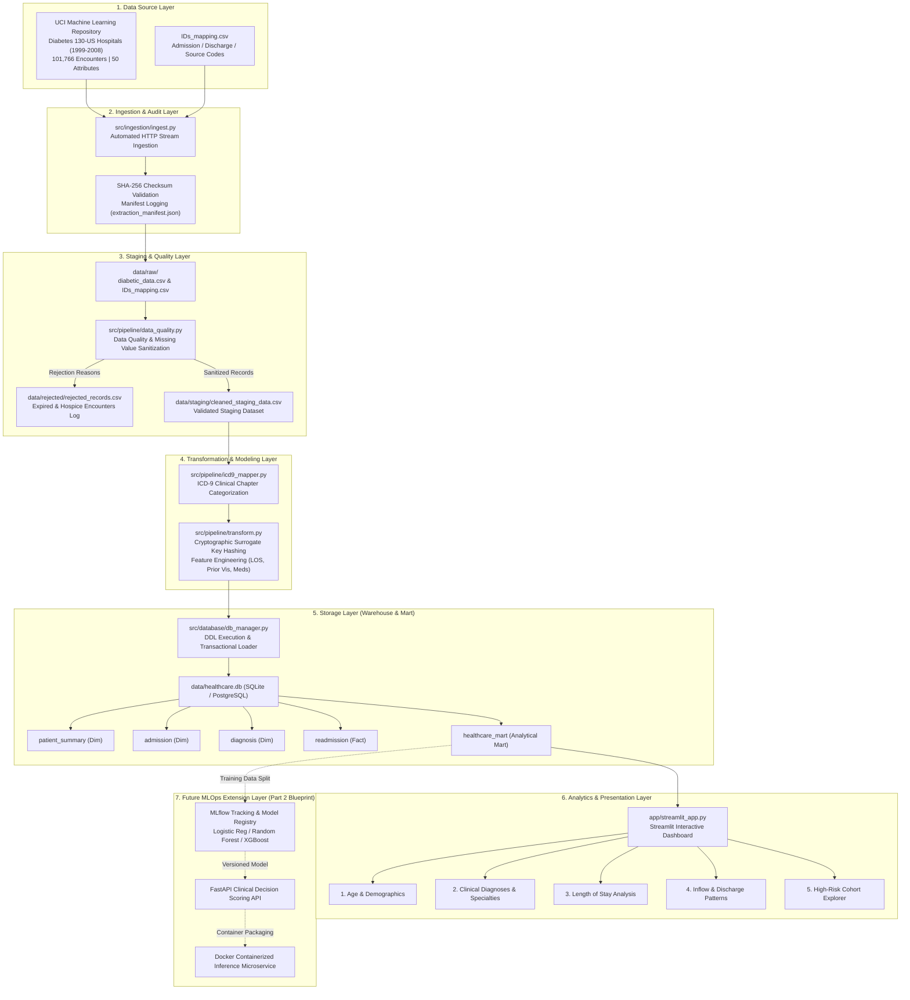

# System Architecture & Healthcare Data Pipeline Flow

**Project**: Hospital Readmission Analytics & Prediction Using Public Data  
**Deliverable**: Assignment Part 1 — Submission Item 5  

---

## 1. High-Level Multi-Tier Architecture Diagram



---

## 2. Detailed Pipeline Data Flow

```
[Raw Public Dataset]
       │ (HTTP Stream Ingestion + Hash Validation)
       ▼
[data/raw/diabetic_data.csv]
       │
       ▼
[Data Quality Audit Engine]
       ├──► [Special Missing Value Handling: '?' -> NaN]
       ├──► [Invalid Records Filter: Deceased / Hospice -> data/rejected/rejected_records.csv]
       └──► [Valid Encounters Staged -> data/staging/cleaned_staging_data.csv]
       │
       ▼
[Transformation & Feature Engineering Engine]
       ├──► [Deterministic SHA-256 Patient & Encounter Surrogate Keys]
       ├──► [ICD-9 Coding -> 9 Clinical Categorical Chapters]
       ├──► [Derived Metrics: Length of Stay, Prior Visits, Active Meds]
       └──► [Readmission Target Classification: <30d, >30d, None]
       │
       ▼
[Relational Dimensional Storage]
       ├──► patient_summary (Patient Dimension)
       ├──► admission (Encounter / Hospitalization Dimension)
       ├──► diagnosis (Clinical Diagnoses Dimension)
       ├──► readmission (Readmission Outcome Fact)
       └──► healthcare_mart (Denormalized Wide Analytical Mart)
       │
       ▼
[Interactive Clinical Analytics Dashboard]
       ├──► View 1: Readmission by Age Bracket & Demographic Cohort
       ├──► View 2: Clinical Diagnostic Chapters & Medical Departments
       ├──► View 3: Length of Stay vs. 30-Day Readmission Risk Curves
       ├──► View 4: Admission Inflow Sources & Discharge Destinations
       └──► View 5: High-Risk Cohort Interactive Slicing & Patient Export
       │
       ▼
[Future Part 2 MLOps Extension Hook]
       └──► Reproducible Training Split, MLflow Experimentation, FastAPI Serving
```

---

## 3. Layer Specifications

### Layer 1: Data Source Layer
- **Source**: UCI Machine Learning Repository (Diabetes 130-US Hospitals).
- **Format**: CSV wrapped in zip archive with associated lookup table (`IDs_mapping.csv`).
- **Characteristics**: 101,766 de-identified encounter records covering 10 years of clinical practice.

### Layer 2: Ingestion & Provenance Layer
- Programmatic extraction with HTTP streaming and automatic failover.
- Cryptographic SHA-256 digest creation.
- Immutable write-once raw storage in `data/raw/`.
- Ingestion telemetry logged to `data/raw/extraction_manifest.json`.

### Layer 3: Staging & Data Quality Layer
- Identification of domain-specific null masks (`'?'`, `'Unknown/Invalid'`, `'None'`).
- Validation of encounter feasibility: patients who expired during hospitalization (Discharge IDs 11, 19, 20, 21) or were transferred to hospice care (Discharge IDs 13, 14) are clinically ineligible for hospital readmission.
- Segregation and export of non-viable records to `data/rejected/rejected_records.csv` with explicit audit explanations.
- Output staged clean dataset to `data/staging/cleaned_staging_data.csv`.

### Layer 4: Transformation & Feature Engineering Layer
- **Privacy Hardening**: Generating deterministic salted SHA-256 surrogate keys (`PAT_...` and `ENC_...`).
- **Clinical ICD-9 Mapping**: Abstracting over 1,000 granular ICD-9 diagnosis codes into 9 major clinical categories (Circulatory, Respiratory, Digestive, Diabetes, Injury & Poisoning, Musculoskeletal, Genitourinary, Neoplasms, Other).
- **Feature Synthesis**:
  - `prior_admissions`: Aggregate sum of past outpatient, emergency, and inpatient utilization.
  - `diagnosis_count`: Total diagnostic co-morbidities.
  - `active_medication_count`: Quantified polypharmacy indicator across 23 monitored drugs.
  - `readmitted_30d`: High-risk binary endpoint (`<30` days).

### Layer 5: Storage Layer
- Target Database: Embedded high-performance relational storage using SQLite (`data/healthcare.db`) and production-ready PostgreSQL (`sql/schema_postgres.sql`).
- Star-schema dimensional model with explicit foreign key constraints, indexes on analytical filter keys, and unified denormalized mart (`healthcare_mart`).
- Automated verification queries and sample table extraction to `data/sample_tables/`.

### Layer 6: Analytics & Presentation Layer
- Streamlit web interface (`app/streamlit_app.py`) powered by Plotly interactive visualizations.
- Modular layout featuring KPI scorecards, multi-select cohort filters, distribution analyses, risk correlation curves, and drill-down patient tables.

### Layer 7: MLOps Layer (Part 2 Blueprint)
- Foundation built for direct training ingestion.
- Model development benchmarking Logistic Regression, Random Forest, and XGBoost.
- MLflow experiment tracking, model registry, FastAPI REST prediction service, and Docker containerization.
